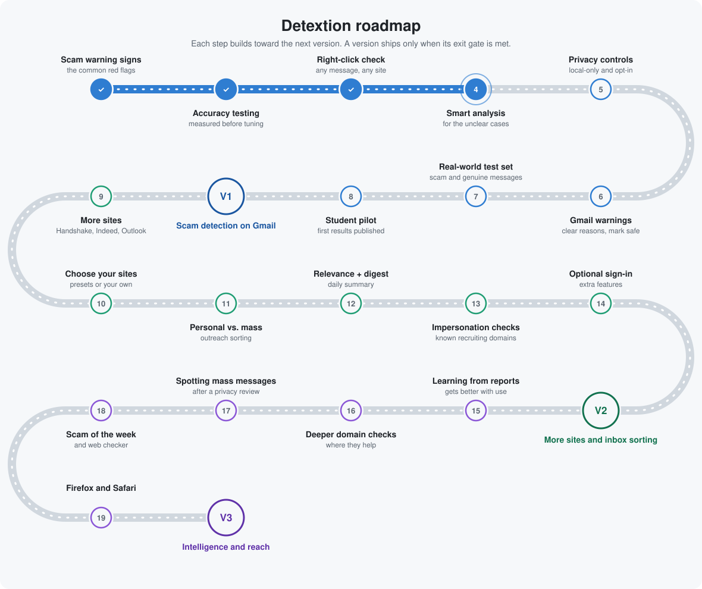

# Detextion

**Catches fake recruiters before they catch you.**

Detextion is a free browser extension that checks recruiter messages and job postings as you read them, and warns you about likely scams in plain language, right where you are reading.

## Why

Fake recruiters target students and new grads with fake checks, "buy your equipment" schemes, task scams, and requests for Social Security numbers or bank details. Real opportunities also get buried under generic mass outreach and event invites. Detextion is built by a student, for students, to help with both.

## What it will do

- **Warn you in the moment.** A badge appears next to a suspicious message with the specific reasons, such as "asks you to buy equipment before starting," and a clear next step: verify the role on the company's official careers page.
- **Say "suspicious," never "scam."** It shows its evidence and leaves the decision to you, because a wrong accusation against a real offer would cost someone a job.
- **Never delete anything.** You can hide a message, report it, or mark it safe.
- **Respect your privacy.** It only looks at job-related messages on sites you turn on. It can run in a local-only mode, and any online analysis is opt-in.
- **Later, sort your recruiting inbox.** Personal messages from real recruiters on top, mass outreach collapsed into a daily digest, and irrelevant roles muted.

## Roadmap

<picture>
  <source media="(prefers-color-scheme: dark)" srcset="docs/roadmap-dark.svg">
  
</picture>

| Version | What it delivers |
|---|---|
| **V1** | Scam warnings on Gmail, tested on real messages and tried by a small group of students |
| **V2** | More sites (LinkedIn, Handshake, Indeed, Outlook), choose where it runs, and inbox sorting with a daily digest |
| **V3** | Learns from user reports, spots mass messages, a public "scam of the week" page, and Firefox and Safari |

## Where things stand

**Early stage (October 2026).** The plan is set and the name is chosen. Building starts with a collection of real scam and genuine recruiter messages, so accuracy is measured before anything ships.

## Help wanted

Seen a scam recruiter message? Real examples, with personal details removed, make Detextion better. Open an issue or reach out.

## Contact

Built by [Srihas Inaganti](https://github.com/srihasInaganti).
